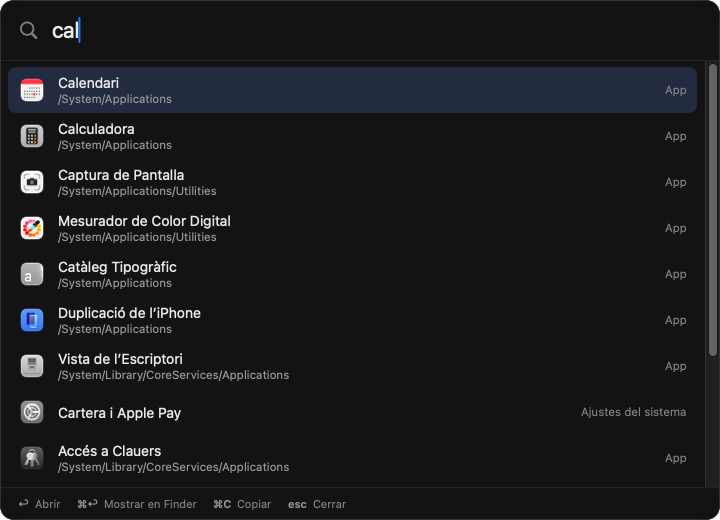
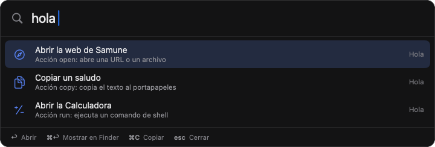
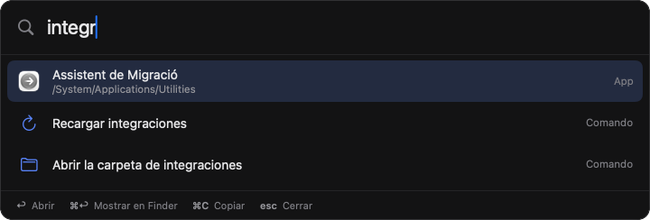
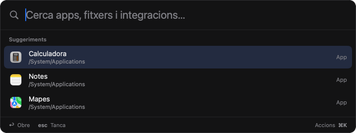
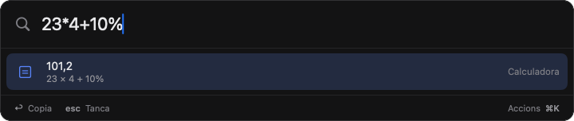
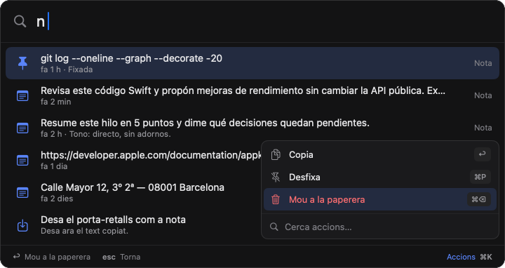
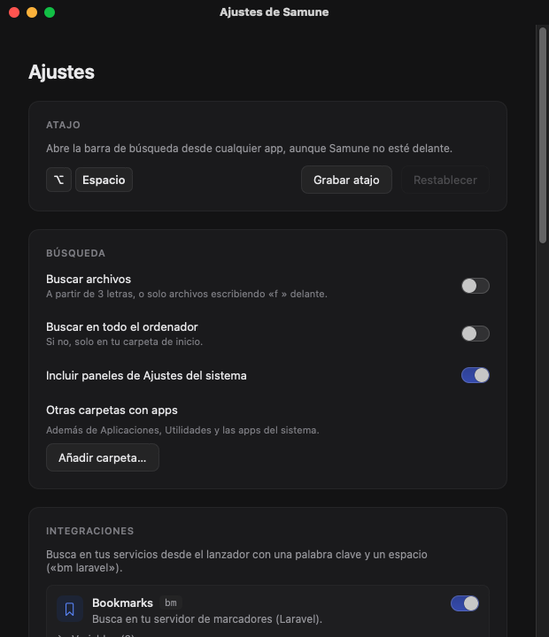

# Samune

Lanzador para buscar apps, archivos y contenido de tus servicios

## Instalar

Abre Terminal y pega:

```sh
curl -fsSL https://raw.githubusercontent.com/drarekx/Samune/main/install.sh | bash
```

El instalador descarga la última versión, la copia en `/Applications` y la abre. Samune vive en la barra de menús; no sale en el Dock.

Samune se actualiza sola: busca versiones nuevas al arrancar y una vez al día (o desde el menú → **Buscar actualizaciones…**), comprueba la descarga con su SHA-256 y se reinicia ya actualizada. Se puede desactivar en Ajustes. Volver a ejecutar el comando de instalación también actualiza.

**Instalación manual:** descarga `Samune.zip` de [Releases](https://github.com/drarekx/Samune/releases/latest), descomprímelo y mueve `Samune.app` a Aplicaciones. La app no está notarizada, así que la primera vez ábrela con clic derecho → **Abrir**.

Requisitos: macOS 14 (Sonoma) o posterior. Apple Silicon o Intel.

## Para qué sirve

Abrir una app, encontrar un archivo o buscar en tus propios servicios sin soltar el teclado. Pulsas un atajo desde cualquier app, escribes unas letras y ↩. Las integraciones son scripts tuyos: cualquier cosa que sepa imprimir JSON se puede listar en Samune.

## Cómo funciona

1. Pulsa **⌥Espacio** (se cambia en Ajustes → Atajo) y escribe. Salen apps y paneles de Ajustes del sistema; lo que más usas sube en la lista.

<p align="center"></p>

2. A partir de tres letras aparecen también archivos y carpetas (Spotlight). Escribe `f ` delante para buscar solo archivos. **↩** abre, **⌘↩** muestra en Finder, **⌘C** copia la ruta, **esc** cierra.

3. Escribe el prefijo de una integración (`hola `, `bm laravel`) para listar su contenido. En Ajustes eliges el prefijo de cada una y si lleva un espacio detrás (`!laravel`).

<p align="center"></p>

4. Samune también tiene sus propios comandos: ajustes, recargar integraciones, salir…

<p align="center"></p>

5. Con el campo vacío salen las apps que más usas y tus notas fijadas.

<p align="center"></p>

6. Escribe una cuenta o una conversión (`23*4+10%`, `10 km a mi`, `120 eur a usd`) y **↩** copia el resultado.

<p align="center"></p>

7. Copia un texto **dos veces seguidas** (⌘C ⌘C) y queda guardado como nota. Escribe `n ` para verlas; **↩** la devuelve al portapapeles.

8. **⌘K** abre las acciones de la fila elegida: mostrar en el Finder, copiar, fijar o tirar una nota… Escribe para filtrarlas.

<p align="center"></p>

9. En Ajustes eliges el atajo, qué se busca y configuras cada integración y las notas.

<p align="center"></p>

## Integraciones

Una integración es una carpeta en `~/Library/Application Support/Samune/Integrations/` con un `manifest.json` y un script (bash, node, python, php…) que imprime JSON con los elementos a listar. Se crean desde Ajustes → Integraciones → **Nueva integración…**, sin recompilar. Las claves secretas se guardan en el Llavero. Vienen dos de ejemplo: `hola` (plantilla comentada) y `bookmarks` (busca en un servidor propio por HTTP).

Guía completa: [docs/integraciones.md](docs/integraciones.md).

## Todo lo que hace

- **Apps y Ajustes del sistema**: coincidencia aproximada (iniciales, trozos de palabra) y orden según lo que más abres.
- **Archivos y carpetas**: con Spotlight, sin permisos extra; no muestra lo que hay dentro de `node_modules`, `build`, cachés ni carpetas ocultas.
- **Integraciones con scripts**: prefijo configurable (con o sin espacio), variables y secretos por integración, caché de resultados.
- **Acciones por fila (⌘K)**: cada resultado tiene las suyas, con atajo propio (⌘P fija una nota, ⌘⌫ la tira); las integraciones pueden declarar más.
- **Calculadora**: operaciones, porcentajes, funciones, unidades (longitud, peso, temperatura, volumen, área, velocidad, tiempo, datos) y monedas con los tipos diarios del Banco Central Europeo.
- **Notas**: guarda solo lo que copias dos veces seguidas, nunca lo que los gestores de contraseñas marcan como oculto. Caducan solas (7 días por defecto), se pueden fijar y pasan por una papelera. Si tenías [Notity](https://github.com/drarekx/Notity), importa sus notas la primera vez.
- **Sugerencias**: con el campo vacío, las apps que más usas y las notas fijadas.
- **Atajo global configurable**, sin permiso de Accesibilidad.
- **Colores**: temas clásicos con sus colores oficiales (Solarized, Dracula, Nord, Gruvbox, Monokai, One Dark, Tokyo Night, Catppuccin, Rosé Pine, Everforest, Kanagawa, GitHub Dark) además del original.
- **Idiomas**: castellano, inglés y catalán.
- **Abrir al iniciar sesión**: se activa la primera vez que se abre desde Aplicaciones; se puede quitar en Ajustes.

¿Te es útil? [Invítame a un café](https://buymeacoffee.com/drarek) ☕

## Dónde guarda las cosas

- Ajustes: `defaults read com.egluu.samune`
- Integraciones, notas (`notes.json`), tipos de cambio y uso reciente: `~/Library/Application Support/Samune/`
- Secretos de las integraciones: Llavero (servicio `com.egluu.samune.integrations`)

## Desinstalar

```sh
osascript -e 'quit app "Samune"'
rm -rf /Applications/Samune.app ~/Library/Application\ Support/Samune
defaults delete com.egluu.samune
```

## Compilar desde el código

```sh
git clone https://github.com/drarekx/Samune.git
cd Samune
./build-app.sh          # deja build/Samune.app y build/Samune.zip
open build/Samune.app
```

Con Xcode 16+ el binario es universal (arm64 + x86_64); solo con las Command Line Tools se compila para la arquitectura del Mac.

Para publicar una versión nueva, crea y sube una etiqueta; GitHub Actions compila la app y crea el release con el zip:

```sh
git tag v1.0.1 && git push origin v1.0.1
```
